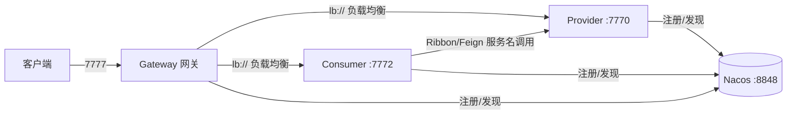

# 微服务Demo 构建流程导读（优化版）

> 配套说明：本导读与工程内各源码/配置文件中添加的**尾注注释**一一对应。目标有二：
> 1. 按"从零到跑通"的先后顺序，把本项目是怎么搭起来的一条条讲透；
> 2. 提炼**可迁移到任意微服务项目**的通用套路（标注 ✅ 通用技巧），供考核与实战复用。
>
> 只解读，不改任何代码逻辑。

---

## 一、项目概览

| 模块 | 端口 | 角色 | 关键组件 |
|------|------|------|----------|
| Father1（父工程） | - | 聚合 + 版本管理 | Maven `packaging=pom` |
| Provider | 7770 | 服务提供者 | Nacos 注册 + 配置中心 |
| Consumer | 7772 | 服务消费者 | Ribbon + OpenFeign |
| Gateway | 7777 | API 网关 | Spring Cloud Gateway |

技术栈：**Spring Boot 2.3.2 + Spring Cloud Hoxton.SR8 + Spring Cloud Alibaba 2.2.5 + Nacos**（Java 8 / Maven 父子聚合）。



---

## 二、技术栈与版本对应关系（为什么这么配）

微服务三件套版本必须配套，本项目已在父工程统一，可整体照抄：

| 组件 | 版本 | 说明 |
|------|------|------|
| Spring Boot | 2.3.2.RELEASE | 微服务基础框架 |
| Spring Cloud | Hoxton.SR8 | 与 Boot 2.3.x 匹配的版本线 |
| Spring Cloud Alibaba | 2.2.5.RELEASE | 与 Hoxton 匹配，提供 Nacos 组件 |
| Nacos | 2.x（服务端） | 注册中心 + 配置中心，默认 8848 |
| JDK / Maven | 1.8 / 3.x | 编译与构建 |

> ✅ 通用技巧：**版本不配套是最常见的坑**。三种版本存在一张"对应关系表"，选定 Boot 版本后，Cloud / Alibaba 版本要按官方对照表选，不能随便取。本项目集中定义在父工程 `properties`，改一处即可整体升级。

---

## 三、目录结构

```
test/                        # 父工程 Father1
├── pom.xml                  # 聚合 + 版本管理 + 镜像仓库
├── Provider/                # 服务提供者
│   ├── pom.xml
│   └── src/main/
│       ├── java/org/example/
│       │   ├── ProviderApplication.java        # @EnableDiscoveryClient 注册到 Nacos
│       │   └── controller/
│       │       ├── HelloController.java        # 返回服务名+端口，用于验证负载均衡
│       │       └── ConfigClientController.java # 配置中心热刷新演示
│       └── resources/
│           ├── application.yml   # 端口、服务名、注册中心地址
│           └── bootstrap.yml     # 引导配置（连接配置中心）
├── Consumer/                # 服务消费者（负载均衡核心）
│   ├── pom.xml
│   └── src/main/
│       ├── java/org/example/
│       │   ├── ConsumerApplication.java        # @LoadBalanced RestTemplate
│       │   ├── controller/  (FeignController / RibbonController)
│       │   └── service/     (FeignService / RibbonService)
│       └── resources/application.yml
└── Gateway/                 # API 网关
    ├── pom.xml
    └── src/main/
        ├── java/org/example/GatewayApplication.java
        ├── filter/                              # ★ 可新增：网关拦截器(GlobalFilter)目录
        └── resources/application.yml            # 路由规则（lb:// 服务名转发）
```

---

## 四、从 0 到运行的完整构建流程（详版）

### 阶段 1：父工程骨架（`pom.xml`）——先立"主心骨"

**做 4 件事：**

1. **改打包方式**：`<packaging>pom</packaging>`，表示这是聚合/管理型工程，本身不产 jar。
2. **声明聚合模块**：`<modules>` 列出 Provider / Consumer / Gateway。之后在根目录一条 `mvn install` 即可按依赖关系**一次构建全部子模块**。
3. **集中定义版本**：`<properties>` 放 Boot / Cloud / Alibaba / JDK 版本号。
4. **统一版本管理**：`<dependencyManagement>` + `type=pom, scope=import` 导入三个官方 BOM；再按需声明自选组件版本（如 mybatis-plus）。

```xml
<!-- 只看关键点 -->
<packaging>pom</packaging>
<modules><module>Provider</module>...</modules>          <!-- 聚合 -->
<dependencyManagement>
    <dependency>
        <groupId>com.alibaba.cloud</groupId>
        <artifactId>spring-cloud-alibaba-dependencies</artifactId>
        <version>${alibaba-cloud.version}</version>
        <type>pom</type><scope>import</scope>            <!-- 导入 BOM，子模块免写版本号 -->
    </dependency>
</dependencyManagement>
```

> ✅ 通用技巧：**"聚合工程 = modules + dependencyManagement"** 是微服务多模块的标准骨架。子模块只写 `groupId:artifactId`，版本号全部来自父工程——这也是规避"一个项目里同个组件多个版本"的规范做法。
> ✅ 通用技巧：国内构建务必配**阿里云镜像仓库**（`repositories`），否则从中央仓库拉依赖可能很慢或超时。

---

### 阶段 2：服务提供者 Provider——让一个服务"能被找到"

**做 3 件事：**

1. **加依赖**（`Provider/pom.xml`）：
    - `spring-cloud-starter-alibaba-nacos-discovery`：注册到 Nacos（服务发现）
    - `spring-boot-starter-web`：提供 HTTP 接口
    - `spring-cloud-starter-alibaba-nacos-config`：接入配置中心（本项目演示）
2. **开启注册**（`ProviderApplication`）：`@SpringBootApplication` + `@EnableDiscoveryClient`。启动后本服务实例自动上报到 Nacos，服务名取 `application.yml` 里的 `spring.application.name: provider`。
3. **提供接口**（`HelloController`）：用 `@Value("${server.port}")` 注入端口并拼进返回值——**这是验证负载均衡埋的观察点**：多开几个 Provider 实例，刷新时端口轮换即负载均衡生效。

```yaml
# Provider/src/main/resources/application.yml
server:
  port: 7770                    # 本服务端口
spring:
  application:
    name: provider              # 服务名：注册中心里的唯一标识，其他服务/网关按它调用
  cloud:
    nacos:
      discovery:
        server-addr: 127.0.0.1:8848   # Nacos 注册中心地址
```

> ✅ 通用技巧：**`spring.application.name` 是微服务的"身份证"**，必须全局唯一，且是服务间调用的依据。
> ✅ 通用技巧：`@EnableDiscoveryClient` 在 Nacos 场景下其实可省略（自动装配），但显式写出更利于理解、也更保险。

---

### 阶段 3：配置中心（Provider/bootstrap.yml + ConfigClientController）——配置与代码分离

**做 3 件事：**

1. **引导配置**：`bootstrap.yml` 比 `application.yml` **更早加载**，用来先连上 Nacos 配置中心。
2. **定位远程配置**：`profiles.active: dev` + `file-extension: yaml` 拼接出 **dataId = `provider-dev.yaml`**，启动时去 Nacos 拉取。
3. **热刷新**：在要动态更新的 Controller 上标 `@RefreshScope`，`@Value` 注入的配置项在 Nacos 改动后**无需重启**自动刷新。

```yaml
# bootstrap.yml（关键行）
spring:
  profiles:
    active: dev                        # 激活 dev 环境 → 对应 provider-dev.yaml
  cloud:
    nacos:
      config:
        server-addr: 127.0.0.1:8848
        file-extension: yaml            # dataId = {服务名}-{profile}.{后缀}
```

> ✅ 通用技巧：**连接配置中心的"前置配置"必须放 bootstrap**（如 Nacos 地址），放 application 里会晚一步、可能连不上。
> ✅ 通用技巧：多环境切换（dev/prod/test）就是改 `profiles.active`，配合 Nacos 里按环境建不同 dataId 的配置，不用改代码。
> ✅ 通用技巧：需要"改配置不重启"的 Bean 加 `@RefreshScope`；不加则只在启动时读一次。

---

### 阶段 4：服务消费者 Consumer——两种负载均衡实现（考核核心）

**做 2 件事：先注册，再选一种调用方式。**

**方式一：RestTemplate + Ribbon（编程式）**
```java
@Bean
@LoadBalanced                        // 关键：给 RestTemplate 装上"负载均衡能力"
public RestTemplate getRestTemplate() { return new RestTemplate(); }
```
调用时 URL 写**服务名**而不是 IP:端口：
```java
restTemplate.getForObject("http://provider/provider/hello", String.class);
```
**执行链路**：Ribbon 从 Nacos 拉到 provider 全部实例列表 → 按策略（默认轮询）选一个 → 发起真实请求。

**方式二：OpenFeign（声明式）**
```java
@EnableFeignClients                  // 启动类上开启，扫描 @FeignClient 接口
@FeignClient(name = "provider")      // 声明目标服务名
public interface FeignService {
    @GetMapping("/provider/hello")   // 目标服务内的映射
    String getFeign();
}
```
Feign 自动生成代理实现，**像调用本地方法一样发远程请求**，内部同样走负载均衡。

> ✅ 通用技巧：Ribbon 与 Feign 只是"调用姿势"不同，**负载均衡的本质 = 服务实例列表 + 客户端选一个**。谁来选？——客户端（Ribbon/Feign/Gateway 内置 LoadBalancer）。考核常问这句话。
> ✅ 通用技巧：只要用**服务名 URL**（`http://服务名/...`）就必须有负载均衡器解析；否则会报 `UnknownHostException`。Feign 同理，`@FeignClient(name)` 里的名字必须和注册中心里的服务名完全一致。

---

### 阶段 5：网关 Gateway——统一入口 + 动态路由

**做 2 件事：**

1. **网关也注册 Nacos**：`@EnableDiscoveryClient`，这样才能按服务名发现下游实例。
2. **配路由**（`application.yml`），逐项释义：

```yaml
server:
  port: 7777                        # 统一入口端口，所有外部请求先到它这里
spring:
  application:
    name: gateway
  cloud:
    nacos:
      discovery:
        server-addr: localhost:8848
    gateway:
      routes:                       # 路由表：一条 route = 命中谓词 → 转发到目标
        - id: provider              # 路由唯一标识（自定义）
          uri: lb://provider        # lb:// = 按服务名从 Nacos 负载均衡取实例
          predicates:
            - Path=/provider/**     # 以 /provider/ 开头的请求 → 转发 provider
        - id: consumer
          uri: lb://consumer        # 网关侧同样具备负载均衡能力
          predicates:
            - Path=/consumer/**
```

**网关内部完整处理顺序**（面试常问）：
```
请求进入 → 路由匹配(Predicate) → 过滤器链(Filter Chain) → 转发到目标服务 → 响应返回
```

> ✅ 通用技巧：**`lb://服务名`** 是网关负载均衡的关键写法；`Path` 是最常用的路由谓词，还可组合 `Method`、`Header`、`Query`、`Cookie`、`After/Before` 等实现更精细的路由。
> ✅ 通用技巧：网关是整个系统的"门面"，统一在这里做鉴权、限流、日志、跨域，比在每个微服务里重复做更规范——这正是阶段 6 的内容。

---

### 阶段 6：启动与联调顺序（跑通全链路）

```text
1. 启动 Nacos（注册中心 + 配置中心）          → 127.0.0.1:8848
2. 启动 Provider（可多开几个，改端口）        → 7770 / 7771 / ...
3. 启动 Consumer                              → 7772
4. 启动 Gateway                               → 7777
5. 验证（走网关统一入口）：
   http://localhost:7777/consumer/feign       → Feign 调用
   http://localhost:7777/consumer/ribbon      → Ribbon 调用
   http://localhost:7777/provider/hello       → 网关直通 provider
6. 观察负载均衡：多开 Provider 后刷新，返回值端口轮换 = 生效
7. 验证配置中心：Nacos 建 provider-dev.yaml，改 config.info，刷新 /provider/config/info 热更新
```

---

## 五、★ 扩展：网关拦截器（GlobalFilter）构建流程

> 网关在转发前后可以统一拦截请求做处理，这就是**网关过滤器**。Spring Cloud Gateway 里有两类：
> - **GatewayFilter（局部）**：只对指定路由生效，可配置化；
> - **GlobalFilter（全局）**：对**所有**路由生效，实现统一鉴权/日志/限流/跨域——这是"拦截器"最常用的形态。

### 5.1 过滤器执行模型（先理解再写）

```
请求 → 多个 GlobalFilter 按 order 从小到大依次执行 → 转发目标服务 → 响应原路返回
```
- 每个过滤器实现两个关键方法：`filter()`（处理逻辑）与 `getOrder()`（执行顺序）。
- 通过 `chain.filter(exchange)` **放行**给下一个过滤器；不放行即"拦截"（直接返回响应）。

### 5.2 构建步骤（三步走）

1. **新建包**：`Gateway/src/main/java/org/example/filter/`（与项目分层风格一致）。
2. **写一个过滤器类**：`implements GlobalFilter, Ordered` + `@Component` 注册到 Spring。
3. **在 `filter()` 里写拦截逻辑**，用 `getOrder()` 控制顺序（数字越小越先执行）。

### 5.3 完整示例：统一登录鉴权过滤器（可直接照抄学习）

```java
package org.example.filter;

import org.springframework.cloud.gateway.filter.GatewayFilterChain;
import org.springframework.cloud.gateway.filter.GlobalFilter;
import org.springframework.core.Ordered;
import org.springframework.http.HttpStatus;
import org.springframework.http.server.reactive.ServerHttpRequest;
import org.springframework.stereotype.Component;
import org.springframework.web.server.ServerWebExchange;
import reactor.core.publisher.Mono;

/**
 * 网关全局拦截器：登录鉴权
 * 作用：所有经过网关的请求，先校验 Header 中的 token；无 token 或非法则直接返回 401，不放行
 */
@Component                 // 交给 Spring 管理，自动被网关装配
public class AuthGlobalFilter implements GlobalFilter, Ordered {

    @Override
    public Mono<Void> filter(ServerWebExchange exchange, GatewayFilterChain chain) {
        // 1. 从请求头取出 token
        ServerHttpRequest request = exchange.getRequest();
        String token = request.getHeaders().getFirst("token");

        // 2. 鉴权判断：token 为空或非法 → 拦截（返回 401，不调用 chain.filter 即不放行）
        if (token == null || !"123456".equals(token)) {
            exchange.getResponse().setStatusCode(HttpStatus.UNAUTHORIZED);
            return exchange.getResponse().setComplete();   // 直接结束，不再转发
        }

        // 3. 放行：把请求交给下一个过滤器/转发到目标服务
        return chain.filter(exchange);
    }

    @Override
    public int getOrder() {
        return -100;   // 数字越小越先执行；负值表示优先于大多数内置过滤器
    }
}
```

**一个"记录访问日志"的过滤器**（演示先放行、再在响应后打日志）：
```java
@Component
public class LogGlobalFilter implements GlobalFilter, Ordered {
    @Override
    public Mono<Void> filter(ServerWebExchange exchange, GatewayFilterChain chain) {
        System.out.println(">>> 请求进入网关: " + exchange.getRequest().getURI());
        return chain.filter(exchange).then(Mono.fromRunnable(() ->
                System.out.println("<<< 响应返回: " + exchange.getResponse().getStatusCode())));
    }
    @Override
    public int getOrder() { return -99; }   // 鉴权之后执行
}
```

### 5.4 常用拦截场景扩展

| 场景 | 实现要点 |
|------|----------|
| **统一鉴权** | 读 Header/Cookie 中的 token，调认证服务或本地校验，失败返回 401/403 |
| **统一日志** | `chain.filter(exchange).then(...)` 在转发前/后分别记录请求与响应 |
| **跨域 CORS** | 实现 `CorsWebFilter`，设置允许来源/方法/头 |
| **限流** | 结合 Redis + `RequestRateLimiter` 过滤器，按 IP/用户限流 |
| **黑白名单** | 按 IP/路径判断，命中则直接 `setComplete()` |
| **请求头透传/改写** | 用 `ServerHttpRequest.mutate()` 增删改 Header 后再 `chain.filter` |

### 5.5 通用技巧与注意事项

> ✅ **拦截 = 不调用 `chain.filter(exchange)`，直接返回**；放行 = 必须调用 `chain.filter(exchange)`。
> ✅ `getOrder()` 决定执行顺序，**数字越小越先执行**；用负值可让它排在网关内置过滤器之前。
> ✅ 网关基于 **WebFlux 响应式**，返回类型是 `Mono<Void>`，操作的是 `ServerWebExchange`，**不是** Servlet 的 `HttpServletRequest/Response`。
> ✅ 过滤器能拿到的信息：URI、请求头、Cookie、Query 参数、路径等，够鉴权和日志用。
> ✅ 想"只对某条路由生效"时，改用 GatewayFilter 并通过 `spring.cloud.gateway.routes[].filters` 在 yml 里配置，而不是全局过滤器。

---

## 六、通用技巧清单（可迁移到任意微服务项目）

| # | 通用技巧 | 用法 |
|---|----------|------|
| 1 | 聚合工程骨架 | `packaging=pom` + `modules` + `dependencyManagement(import BOM)` |
| 2 | 版本配套表 | Boot / Cloud / Alibaba 三版本必须配套，集中在父工程 properties |
| 3 | 服务名即身份证 | `spring.application.name` 全局唯一，服务间按它调用 |
| 4 | 注册 = `@EnableDiscoveryClient` | 每个服务都要注册到 Nacos，网关也不例外 |
| 5 | 负载均衡 = 实例列表 + 客户端挑选 | RestTemplate 加 `@LoadBalanced`；Feign 用 `@FeignClient`；网关用 `lb://` |
| 6 | 调用用服务名而非 IP | `http://provider/...`，否则 `UnknownHost` |
| 7 | 配置中心前置配置放 bootstrap | 连接 Nacos 的配置放 bootstrap.yml，比 application 更早加载 |
| 8 | 热刷新 = `@RefreshScope` | 改配置不重启，Nacos 自动推送到 Bean |
| 9 | 网关统一入口 | 鉴权/日志/限流/跨域都放网关，避免各服务重复 |
| 10 | 网关路由 `lb://服务名` + Path 谓词 | 动态发现下游，天然负载均衡 |
| 11 | 全局拦截 = GlobalFilter | `@Component` + `implements GlobalFilter, Ordered`，`getOrder()` 控顺序 |
| 12 | 拦截 = 不放行 | 不调 `chain.filter` 即拦截；放行必须调 |

---

## 七、验证方式

1. **静态验证（已完成）**：逐文件复查，确认注释只添加、逻辑零改动；XML 注释无非法字符。
2. **编译验证（可选）**：根目录执行 `mvn clean install -DskipTests`，成功即证明注释未破坏构建。
3. **运行验证**：按"阶段 6"顺序启动并逐项访问，观察负载均衡端口轮换与配置中心热刷新。

---

## 八、常见问题与排查

| 现象 | 原因 / 排查 |
|------|-------------|
| 服务启动报注册失败 | Nacos 未启动，或 `server-addr` 地址/端口不对 |
| 调 `http://provider/...` 报 UnknownHost | RestTemplate 忘了加 `@LoadBalanced` |
| Feign 接口找不到目标 | `@FeignClient(name=...)` 服务名与注册的服务名不一致，或没加 `@EnableFeignClients` |
| 网关 404 | 路由 `Path` 未匹配，或目标服务名写错 |
| 网关 401 | 命中自定义鉴权过滤器且未带合法 token（阶段 5.3 示例） |
| 配置不生效/报错 | bootstrap.yml 未配置，或 Nacos 中未建对应 dataId 的配置 |
| 版本不兼容报错 | Boot / Cloud / Alibaba 三版本不配套（应在父工程统一） |
